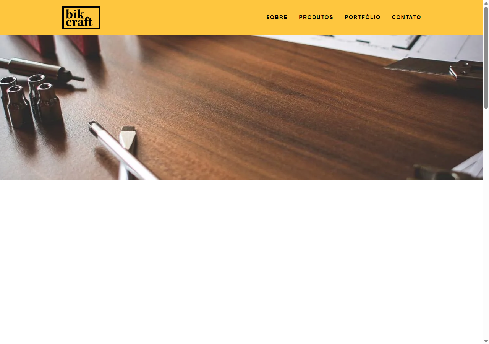

# Bikcraft — Site institucional de bicicletas personalizadas

Site multipágina de uma marca fictícia de bicicletas, feito em 2021 como estudo no curso da **Origamid**. Usa só HTML, CSS e JavaScript, com um formulário de contato que envia e-mail por PHP.

> Projeto de estudo.



## Páginas

| Página | Arquivo | Conteúdo |
|--------|---------|----------|
| Home | `index.html` | Apresentação, linhas de produto, depoimentos em slide |
| Sobre | `sobre.html` | História e equipe |
| Produtos | `produtos.html` | Linhas Passeio, Retrô e Esporte |
| Portfólio | `portfolio.html` | Clientes, com slide navegável |
| Contato | `contato.html` | Formulário, endereço e telefone |

## O que foi praticado

- HTML semântico e layout em grid próprio (`css/grid.css`) com versão responsiva (`css/responsivo.css`).
- Plugins JS escritos do zero:
  - `simple-slide.js`: slides com tempo e navegação (`data-slide`).
  - `simple-anime.js`: animação de elementos ao rolar a página.
  - `simple-form.js`: envio do formulário com feedback.
- Formulário com honeypot anti-bot (campos `leaveblank` e `dontchange`).
- Envio de e-mail por **PHPMailer** (`enviar.php`) ou **SendGrid** (`enviar-sendgrid.php`).

## Estrutura

```
Bikecraft/
├── index.html, sobre.html, produtos.html, portfolio.html, contato.html
├── css/            reset, normalize, grid, estilos por página, responsivo
├── js/             script.js + plugins simple-*
├── img/
├── config.php            carrega o .env e helpers de sanitização
├── .env.example          modelo das variáveis de ambiente
├── enviar.php            envio via SMTP (PHPMailer)
├── enviar-sendgrid.php   envio via SendGrid
└── PHPMailer/ , sendgrid-php/   bibliotecas incluídas no repositório
```

## Como rodar

As páginas abrem direto no navegador (`index.html`).

O formulário precisa de PHP 8:

```bash
php -S localhost:8000
```

### Configuração do envio

As credenciais ficam fora do código, em um arquivo `.env` na raiz do projeto:

```bash
cp .env.example .env
```

Preencha o `.env` com os dados do seu SMTP (`enviar.php`) ou do SendGrid (`enviar-sendgrid.php`). O `.env` está no `.gitignore` e nunca deve ser versionado. Variáveis já definidas no ambiente do servidor têm prioridade sobre o arquivo.

### Lint e validação

```bash
npm ci
npm run lint
```

O `lint` roda `html-validate` nas páginas e `stylelint` nos CSS. Para checar a sintaxe do PHP: `php -l enviar.php`.

## Testes e CI

O workflow `.github/workflows/ci.yml` roda, a cada push e pull request:

- `html-validate` e `stylelint` (`npm run lint`);
- `php -l` em todos os arquivos `.php`;
- Lighthouse CI (`lighthouserc.json`), com metas de 90 em acessibilidade, performance e boas práticas.

## Pendências

- Publicar o site (GitHub Pages) e linkar a URL aqui.
- Formulário na versão estática (Formspree ou Netlify Forms).
- Imagens em WebP/AVIF com `srcset` e `loading="lazy"`.
- Trocar as bibliotecas vendorizadas (`PHPMailer/`, `sendgrid-php/`) por Composer.

## O que aprendi

- Organizar um site multipágina com HTML semântico e menu comum.
- Criar layout em grid sem framework, com versão responsiva.
- Escrever plugins de slide e de animação ao rolar sem bibliotecas.
- Validar formulário no cliente e usar honeypot em vez de CAPTCHA.
- Enviar e-mail por SMTP e por API, tratando erros e campos vindos do usuário.
- Tirar credenciais do código e usar variáveis de ambiente.
- Configurar CI com validação de HTML, CSS, PHP e Lighthouse.
- Modo escuro com `prefers-color-scheme` e variáveis CSS.

## Licença

Este projeto usa **licença dupla**. O texto completo está em [LICENSE](LICENSE).

- **Uso pessoal, educacional e não comercial:** livre, nos termos da licença MIT (mantenha o aviso de copyright).
- **Uso comercial:** exige licença comercial. Isso inclui usar em produto ou serviço comercial, vender acesso ou derivados, usar em atividades com fins lucrativos e implantar em empresas.

Contato para licença comercial: ma.polli@hotmail.com
